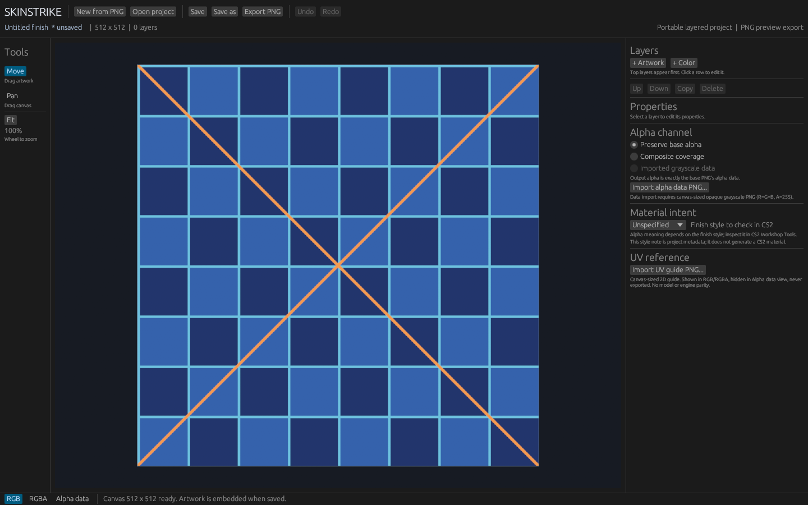

  

<h1 align="center">SkinStrike</h1>

  <a href="https://prowebdevsolutions.com"><picture>
    <source media="(prefers-color-scheme: dark)" srcset="assets/branding/PWDS-logo-orange.svg">
    
  </picture></a>

**Explore a finish in layers.**

SkinStrike lets CS2 creators compose a finish as layered image artwork. Start with a base PNG, add color and positioned art, keep an editable project, and export a full-resolution PNG for review.

## Highlights

- Combine color washes and artwork layers.
- Adjust placement, visibility, and opacity.
- Keep an editable source and export a PNG.

## Development preview from draft PR #1

These are [genuine native captures with exact source provenance](docs/DEVELOPMENT_CREATOR_PREVIEW.md) from [draft PR #1](https://github.com/Gerbzz/SkinStrike/pull/1), built from `91f558d94e4455fede5eb63a27fc5c63332b006d`. They preview painting and a visual project library being developed. The feature code remains on the draft branch; the main branch still has the narrower editor described below. The eight project fixtures were synthetic and were not published.

## Main branch editor preview

This [app-rendered capture](docs/SCREENSHOT_PROVENANCE.md) shows the main-branch native finish canvas with an original synthetic texture. It is a view of one opened image, with no artwork layers yet.

## Current status

Image-authoring prototype. Core layer, alpha, project, CLI, and desktop paths have headless coverage, and one native editor state has been visually inspected. Interactive layer workflows still need hands-on review. Valve-compatible material and texture round trips remain unverified; this does not produce a game-ready skin.

## A finish from source to export

1. Open a base PNG. SkinStrike reads its dimensions, alpha distribution, and SHA-256 fingerprint.
2. Add named color washes and artwork PNG layers. Position, scale, rotate, reorder, hide, and adjust their opacity. Lock a layer to prevent property edits, dragging, reorder, or deletion while still allowing visibility changes; copies start unlocked.
3. Choose how export alpha is produced: preserve base alpha, use composite coverage, or import a canvas-sized opaque grayscale PNG. Imported gray bytes become alpha bytes exactly, with optional inversion; RGB artwork remains separate.
4. Optionally import a canvas-sized UV reference PNG. The adjustable guide appears in RGB/RGBA editor views but stays out of the Alpha data view and the exported PNG. It is a 2D alignment aid, not a verified weapon preview.
5. Save a versioned JSON finish project that embeds the base, artwork, alpha data, and UV guide with SHA-256 integrity checks. Version 2 projects remain portable after their source files are removed; older version 2 projects open with defaults for new fields. Version 1 still needs its original hash-matched base PNG before resaving as version 2.
6. Export a full-resolution PNG. The export path validates and protects project and source-image destinations. The desktop UI asks before replacing an existing PNG; the CLI requires a new output path.

The desktop UI exposes source inspection, a finish project, layer controls, and export paths. The CLI offers the same narrow file workflow for repeatable experiments.

| File | Role |
| --- | --- |
| Source <code>.png</code> | Original input; embedded into a version 2 project on import |
| Finish project <code>.json</code> | Versioned layers, channel settings, embedded assets, and integrity hashes |
| Inspection report <code>.json</code> | Dimensions, alpha counts, and source fingerprint |
| Export <code>.png</code> | Full-resolution image; project and source-image paths are protected |

The editor supports undo/redo, background import and export work, cooperative cancellation, and stale-result checks. An individual PNG decoder call may run until it returns. Imported assets are embedded for portable reopening; the originals are not silently overwritten.

## What the current UI helps you inspect

The desktop window shows the opened texture, layer controls, color and alpha views, UV reference overlay, project and export paths, and operation errors. Alpha data view suppresses the colored UV overlay so grayscale values stay readable. The properties panel scrolls in compact windows.

Material intent records a target finish-style note for the artist; it does not change pixels or generate a CS2 material. Valve's [Weapon Finishes Guide](https://www.counter-strike.net/workshop/workshopfinishes/) describes style-dependent alpha meanings, and [Workshop Resources](https://www.counter-strike.net/workshop/workshopresources) lists official UV sheets and models. No Valve assets are bundled here. Check actual style, UV placement, wear, shading, and weapon appearance in CS2 Workshop Tools.

## Build and try it

Use Windows and a Rust toolchain with edition 2024 support. The first-party desktop app uses egui/eframe; image decoding and PNG writing use Rust libraries.

~~~powershell
cargo test --locked --features native-ui
cargo build --locked --features native-ui --bins
cargo run --locked --features native-ui --bin skinstrike-ui
~~~

For the CLI, start with a source PNG you own and choose new output filenames:

~~~powershell
cargo run --locked --bin skinstrike -- inspect <source.png> <new-report.json>
cargo run --locked --bin skinstrike -- new <source.png> <new-project.json>
cargo run --locked --bin skinstrike -- add-color <project.json> <name> <r> <g> <b> <opacity>
cargo run --locked --bin skinstrike -- export <project.json> <new-output.png>
~~~

Color channels and opacity are integers from 0 to 255. To exercise the new channel and UV workflow with synthetic images, run `cargo run --locked --example channel_uv_smoke -- <new-output-directory>` from this folder. The example produces a decoded export and an offscreen editor render; the latter is not a native-window screenshot.

## Scope and next steps

SkinStrike does not yet offer brush or mask painting, a rotatable verified weapon preview, Valve material generation, or a verified Counter-Strike asset bundle. The native window has compiled, passed headless logic checks, and rendered the documented synthetic texture. Interactive workflow review and clean-machine packaging are still pending.

Limits: 128 layers, 80 characters per layer name, 4096 pixels per PNG side, 32 MiB per PNG file, 64 megapixels across unique referenced decoded assets, and 256 MiB per project JSON. Preview is capped at 1024 pixels; final export uses the full canvas. Existing PNG replacements are limited to 32 MiB. A Valve-compatible round trip remains a future verification gate.

This repository grants no public license for its project source. Third-party crates retain their own licenses.

## PWDS brand artwork

The company mark in this masthead is the existing [official PWDS logo](https://github.com/Gerbzz/PWDS-Website/blob/main/public/prowebdevsolutions-logo.png), with the [official orange display asset](https://prowebdevsolutions.com/images/prowebdevsolutions-logo-orange.svg) for dark backgrounds. Any app logo above it remains the original Strike suite artwork.
