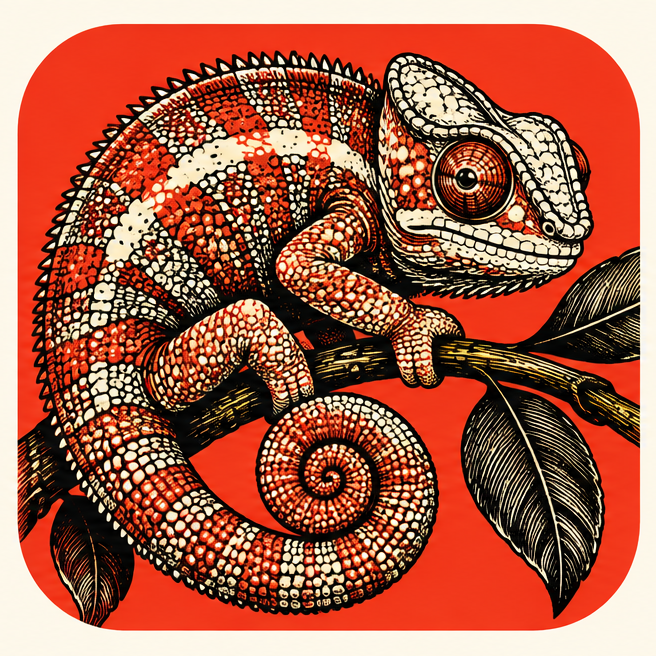
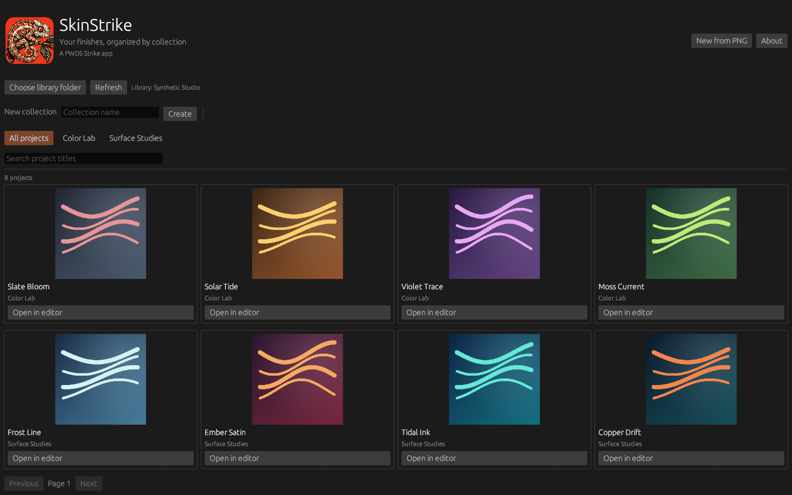
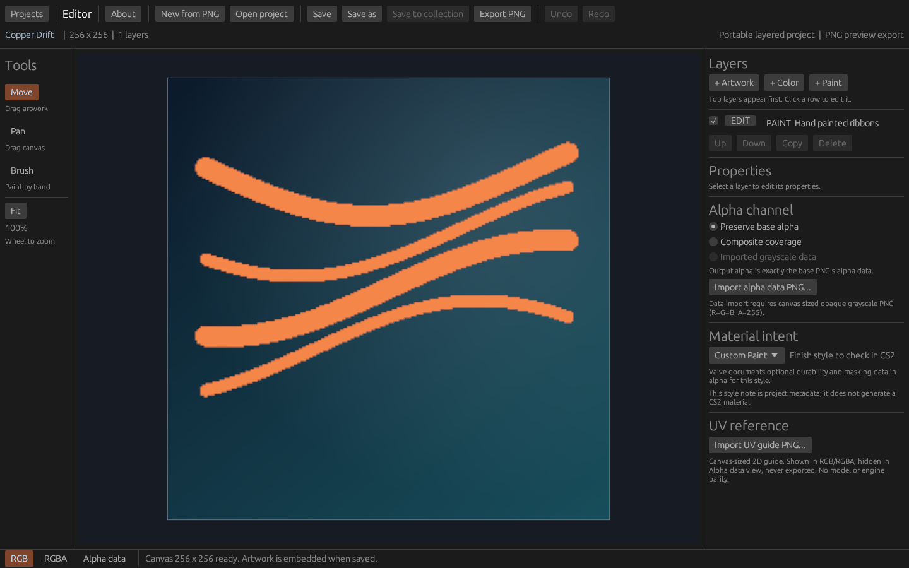

  

<h1 align="center">SkinStrike</h1>

  <a href="https://prowebdevsolutions.com"><picture>
    <source media="(prefers-color-scheme: dark)" srcset="assets/branding/PWDS-logo-orange.svg">
    
  </picture></a>

**Explore a finish in layers.**

SkinStrike lets CS2 creators compose a finish from a base PNG, color, positioned artwork, and hand-painted strokes. Keep an editable project in a local collection, then export a full-resolution PNG for review.

## Highlights

- Combine color washes and artwork layers.
- Paint round-brush strokes on an editable layer, with undo and saved stroke data.
- Adjust placement, visibility, and opacity.
- Find saved finishes by collection and title, with covers rendered from each project.
- Keep an editable source and export a PNG.

## Creator preview

These [native app captures](docs/NATIVE_CREATOR_ACCEPTANCE.md) come from the successful hosted Windows build of this isolated [draft branch](https://github.com/Gerbzz/SkinStrike/tree/feature/project-library-2026-10-15). Every cover is rendered from one local synthetic project; the fixtures and executable are not published. An [earlier editor capture](docs/SCREENSHOT_PROVENANCE.md) remains available for comparison.

## Current status

Image-authoring prototype. Core layer, alpha, project, CLI, and desktop paths have automated coverage. The draft branch adds bounded brush strokes and a local visual project library; its hosted Windows tests pass and its two captured native states were visually inspected. The [acceptance checklist](docs/CREATOR_ACCEPTANCE.md) tracks remaining interaction checks. Valve-compatible material and texture round trips remain unverified; this does not produce a game-ready skin.

## A finish from source to export

1. Open a base PNG. SkinStrike reads its dimensions, alpha distribution, and SHA-256 fingerprint.
2. Add named color washes, artwork PNG layers, or a paint layer. Choose Brush, color, and size to draw on an unlocked visible paint layer. Each stroke is stored with the project and can be undone. Position, scale, rotate, reorder, hide, and adjust layers. Lock a layer to prevent edits; copies start unlocked.
3. Choose how export alpha is produced: preserve base alpha, use composite coverage, or import a canvas-sized opaque grayscale PNG. Imported gray bytes become alpha bytes exactly, with optional inversion; RGB artwork remains separate.
4. Optionally import a canvas-sized UV reference PNG. The adjustable guide appears in RGB/RGBA editor views but stays out of the Alpha data view and the exported PNG. It is a 2D alignment aid, not a verified weapon preview.
5. Save a versioned JSON finish project that embeds the base, artwork, alpha data, UV guide, and paint strokes. Version 2 projects remain portable after their source files are removed; older version 2 projects open with defaults for new fields. Version 1 still needs its original hash-matched base PNG before resaving as version 2. Choose a local library folder, make collection folders, and save the current finish there to get a real rendered cover and reopenable project card.
6. Export a full-resolution PNG. The export path validates and protects project and source-image destinations. The desktop UI asks before replacing an existing PNG; the CLI requires a new output path.

The desktop UI exposes a project gallery, the finish editor, layer controls, and export paths. The CLI covers the original narrow file workflow; brush and gallery actions currently use the desktop UI or library API.

| File | Role |
| --- | --- |
| Source <code>.png</code> | Original input; embedded into a version 2 project on import |
| Finish project <code>.json</code> | Versioned layers, channel settings, embedded assets, and integrity hashes |
| Inspection report <code>.json</code> | Dimensions, alpha counts, and source fingerprint |
| Export <code>.png</code> | Full-resolution image; project and source-image paths are protected |

The editor supports undo/redo, background import and export work, cooperative cancellation, and stale-result checks. Gallery cards load in a worker and their covers use the saved project's compositor. An individual PNG decoder call may run until it returns. Imported assets are embedded for portable reopening; the originals are not silently overwritten.

## What the current UI helps you inspect

The startup window shows the approved SkinStrike logo, a restrained PWDS credit, local collections, searchable project cards, actual rendered covers, and missing/corrupt project states. The editor shows the opened texture, paint and artwork tools, layers, color and alpha views, UV reference overlay, project and export paths, and operation errors. Alpha data view suppresses the colored UV overlay so grayscale values stay readable. The properties panel scrolls in compact windows.

Material intent records a target finish-style note for the artist; it does not change pixels or generate a CS2 material. Valve's [Weapon Finishes Guide](https://www.counter-strike.net/workshop/workshopfinishes/) describes style-dependent alpha meanings, and [Workshop Resources](https://www.counter-strike.net/workshop/workshopresources) lists official UV sheets and models. No Valve assets are bundled here. Check actual style, UV placement, wear, shading, and weapon appearance in CS2 Workshop Tools.

## Build and try it

Use Windows and a Rust toolchain with edition 2024 support. The first-party desktop app uses egui/eframe; image decoding and PNG writing use Rust libraries.

~~~powershell
cargo test --locked --features native-ui
cargo build --locked --features native-ui --bins
cargo run --locked --features native-ui --bin skinstrike-ui
~~~

For the CLI, start with a source PNG you own and choose new output filenames:

~~~powershell
cargo run --locked --bin skinstrike -- inspect <source.png> <new-report.json>
cargo run --locked --bin skinstrike -- new <source.png> <new-project.json>
cargo run --locked --bin skinstrike -- add-color <project.json> <name> <r> <g> <b> <opacity>
cargo run --locked --bin skinstrike -- export <project.json> <new-output.png>
~~~

Color channels and opacity are integers from 0 to 255. To exercise the new channel and UV workflow with synthetic images, run `cargo run --locked --example channel_uv_smoke -- <new-output-directory>` from this folder. The example produces a decoded export and an offscreen editor render; the latter is not a native-window screenshot.

## Scope and next steps

SkinStrike's draft offers a simple round brush, not advanced mask painting or pressure-sensitive brush dynamics. It has no rotatable verified weapon preview, Valve material generation, or verified Counter-Strike asset bundle. The current hosted editor compiled, passed automated tests, and rendered the documented synthetic projects in real native windows. Hands-on interaction review and clean-machine packaging are still pending.

Limits: 128 layers, 80 characters per layer name, 4096 pixels per PNG side, 32 MiB per PNG file, 64 megapixels across unique referenced decoded assets, and 256 MiB per project JSON. Preview is capped at 1024 pixels; final export uses the full canvas. Existing PNG replacements are limited to 32 MiB. A Valve-compatible round trip remains a future verification gate.

The [focused foundation review](docs/FOUNDATION_CHOICE_2026-10-15.md) explains why this draft retains its Rust document and renderer instead of importing a larger photo or 3D painting engine. No code or artwork was copied from those references.

This repository grants no public license for its project source. Third-party crates retain their own licenses.

## PWDS brand artwork

The company mark in this masthead is the existing [official PWDS logo](https://github.com/Gerbzz/PWDS-Website/blob/main/public/prowebdevsolutions-logo.png), with the [official orange display asset](https://prowebdevsolutions.com/images/prowebdevsolutions-logo-orange.svg) for dark backgrounds. Any app logo above it remains the original Strike suite artwork.
