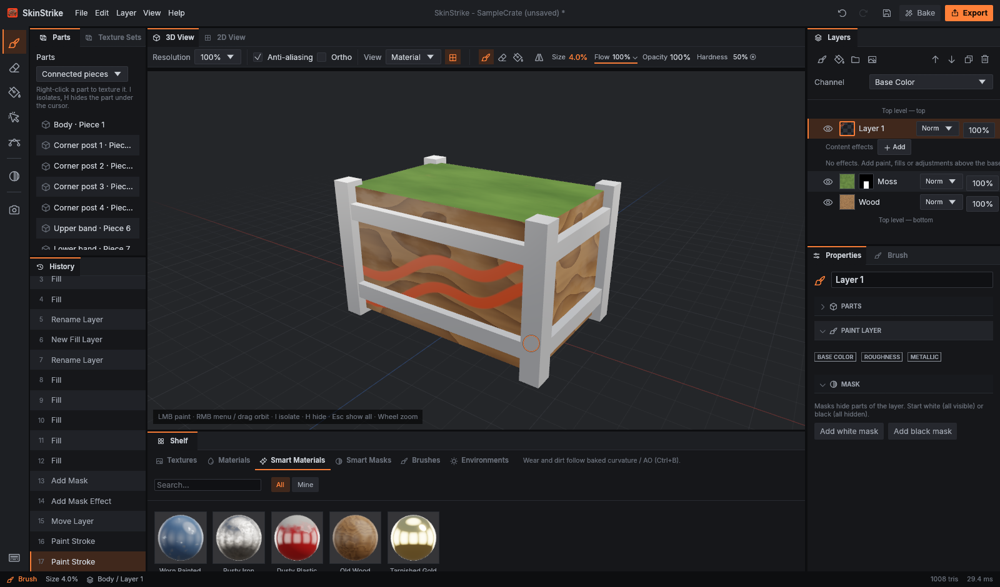

  

<h1 align="center">SkinStrike</h1>

  <a href="https://prowebdevsolutions.com"><picture>
    <source media="(prefers-color-scheme: dark)" srcset="assets/branding/PWDS-logo-orange.svg">
    
  </picture></a>

**Explore a finish in layers.**

## Rust direction and migration status

- **Target:** A Rust-native 3D texture-authoring application built on the selected SubCraft foundation, starting with CS2 requirements; the legacy 2D editor is not the final selected application.
- **Current implementation:** The [pinned 3D foundation candidate](docs/FOUNDATION_CANDIDATE.md) is already Rust and has its own explicit entry point. The separate root [Cargo package](Cargo.toml) and [library](src/lib.rs) remain the preserved Rust 2D editor, not an accepted replacement for the 3D target.
- **Remaining migration:** Complete 3D candidate integration and native workflow/asset acceptance before adoption. This is an unfinished application transition, not a new language port; no automatic legacy-project conversion, completed 3D migration or game-ready output is claimed.

## 3D foundation candidate

The primary 3D development candidate is now the preserved full SubCraft 0.1.7 app at `foundation/subcraft`, with explicit entry point `./SkinStrike-3D.ps1`. Run `./SkinStrike-3D.ps1 -Action Info` to inspect its exact source, feature and executable path without building or launching. See [candidate provenance, retained features and acceptance gates](docs/FOUNDATION_CANDIDATE.md).

**Earlier local evaluation (historical):** its native export suite compiled and executed with **18 passing tests** on `7958dc6`. Windows Application Control then blocked a dependency build script for the candidate UI tests (4551); those tests did not compile or execute, and were not retried. The desktop app has not been built or launched locally. See the [exact verification and remaining gate](docs/verification/2026-10-21-subcraft-native-gates.md). The root Cargo package, source, and projects belong to the preserved **legacy 2D editor**. No executable or editable project was replaced or converted. The 3D entry point never falls back to that editor.

## Active 3D preview

Genuine native capture of the selected 3D foundation at `c7d7a1a6`, built and run in
[hosted capture run 40234535679](https://github.com/Gerbzz/SkinStrike/actions/runs/40234535679).
It shows the unmodified built-in procedural sample crate, rendered with Mesa software
Vulkan under Xvfb—not CS2 assets or a game-ready skin. The candidate's header and title use SkinStrike with the approved artwork;
upstream source ancestry and legal credits are preserved.
[Exact source, binary and image provenance](docs/ACTIVE_3D_SCREENSHOT_PROVENANCE.md)
records the visual inspection and limits. This hosted capture does not resolve the
separate local Windows Application Control block or establish full workflow acceptance.
The older 2D screenshots remain available only in the separate historical documentation.

## Older 2D projects

The root Cargo package is the preserved, superseded 2D editor, not the selected 3D application. Existing 2D JSON projects do not automatically convert to `.subcraft`; preserve those projects and compatibility paths during the unfinished transition. Its [historical documentation and screenshots](docs/HISTORICAL_2D_EDITOR.md) are kept separately, not presented as the current app.

This repository grants no public license for its project source. Third-party crates retain their own licenses.

## PWDS brand artwork

The company mark in this masthead is the existing [official PWDS logo](https://github.com/Gerbzz/PWDS-Website/blob/main/public/prowebdevsolutions-logo.png), with the [official orange display asset](https://prowebdevsolutions.com/images/prowebdevsolutions-logo-orange.svg) for dark backgrounds. Any app logo above it remains the original Strike suite artwork.
